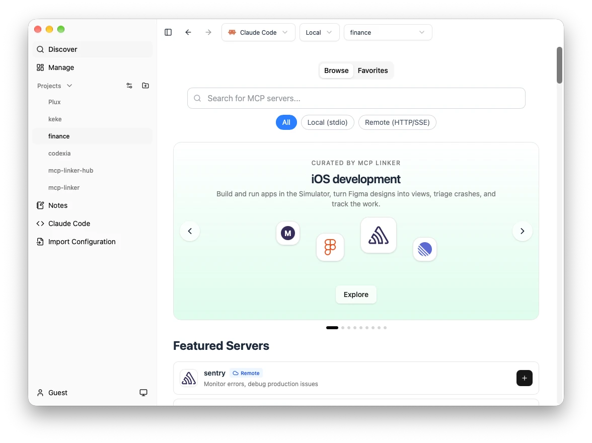
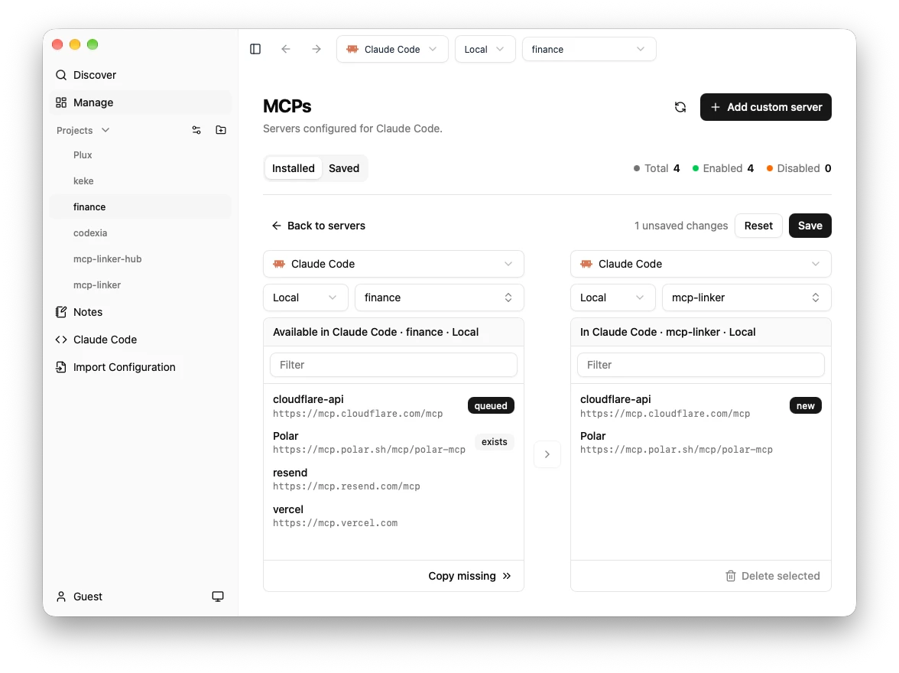

# MCP Linker

軽量なTauri GUIを使用して、Claude Desktop、Cline、CursorなどのAIクライアント間でMCP（モデルコンテキストプロトコル）サーバー設定を同期および管理し、内蔵のMCPマーケットプレイスをサポートします。


## 主な機能

- ワンクリックで MCP サーバーのインストールと設定
- 複数の AI クライアントに対応（Claude Desktop、Cursor、VS Code、Cline、Roo Code、Windsurf など）
- 600 以上の厳選された MCP サーバーを利用可能
- クロスプラットフォーム：macOS、Windows、Linux
- Python、Node.js、UV 環境を自動検出
- お気に入りサーバーのクラウド同期
- Tauri で構築 - 軽量 (約 6 MB)、起動が速く、リソース使用量が少なく、安全です。

## 主なメリット

**Claude のサーバー設定を他の MCP クライアントと同期できます。**  
コピー＆ペーストはもう不要です。

## クイックスタート

1. [最新リリースをダウンロード](https://github.com/milisp/mcp-linker/releases)
2. MCP サーバーをリストから選択
3. 「追加」をクリックして自動でインストールと設定
4. お使いの AI クライアントですぐに使用可能

## スクリーンショット

| サーバー管理                    | サーバー探索                    | ローカル同期                            |
| ------------------------------- | ------------------------------- | ------------------------------- |
|  |  |  |

## 開発手順

```bash
git clone https://github.com/milisp/mcp-linker
cd mcp-linker
bun install
cp .env.example .env
bun tauri dev
```

必要要件：Node.js 20 以上、Bun、Rust ツールチェーン

## アーキテクチャ

- フロントエンド: Tauri + React + shadcn/ui
- バックエンド: オプションの FastAPI

## コントリビュート

詳細は [CONTRIBUTING.md](./CONTRIBUTING.md) を参照してください。

## サポート

- [Discord コミュニティ](https://discord.gg/G9uJxjpd)
- [GitHub Issues](https://github.com/milisp/mcp-linker/issues)

## 🎉 貢献者の皆さま

このプロジェクトの改善にご協力いただいた皆さまに感謝します：

- [@eltociear](https://github.com/eltociear) — 日本語翻訳
- [@devilcoder01](https://github.com/devilcoder01) — Windows ビルドの互換性、セットアップ手順、GitHub ワークフロー、UI 改善、デザイン向上

---

⭐ このプロジェクトが役に立ったら、GitHub にスターを付けてください！ [](https://github.com/milisp/mcp-linker)
